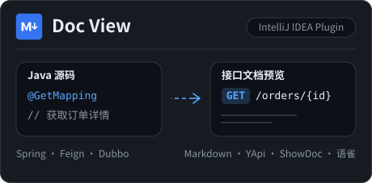
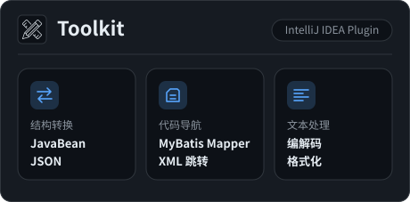
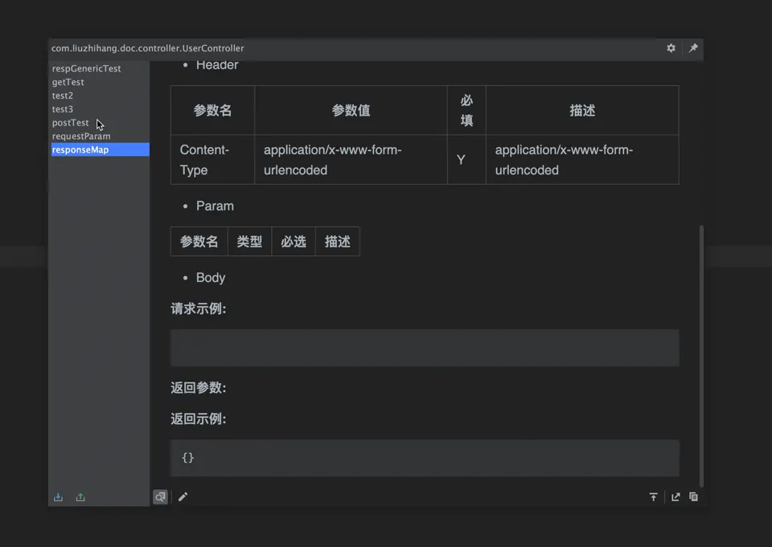
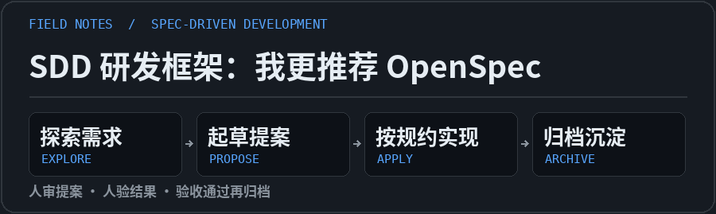

<picture>
  <source media="(prefers-color-scheme: light)" srcset="./assets/hero-workbench-light.svg">
  
</picture>

  
  
  

## 👋 关于我

Java 后端开发者、IntelliJ IDEA 插件作者、开源贡献者。

- 🧩 [Doc-View](https://github.com/liuzhihang/doc-view) 开发者，在 IntelliJ IDEA 里快速生成接口文档。
- 🧪 多 Agent 协作探索者，实践从需求到交付的研发自动化。
- ✍️ 踩坑记录分享员，在博客、公众号和 [X](https://x.com/liuzhihangs) 分享实战笔记。
- 🏃 理论跑步爱好者，偶尔爬山选手，随缘撸铁党。
- 🎮 金铲铲猪脑过载选手，LOLM 手残党，王者混分大王。

## 🧩 开源作品

<table width="100%">
  <tr>
    <td width="50%" valign="top">
      <a href="https://plugins.jetbrains.com/plugin/15305-doc-view"><picture><source media="(prefers-color-scheme: light)" srcset="./assets/plugin-doc-view-light.svg"></picture></a>
      
支持 Spring、Feign、Dubbo，可预览接口文档并导出 Markdown。

      
  

      
<a href="https://plugins.jetbrains.com/plugin/15305-doc-view">安装插件</a> · <a href="https://github.com/liuzhihang/doc-view">查看源码</a> · <a href="https://github.com/liuzhihang/doc-view/issues/new?template=feature_request.md">提需求</a>

    </td>
    <td width="50%" valign="top">
      <a href="https://plugins.jetbrains.com/plugin/12384-toolkit"><picture><source media="(prefers-color-scheme: light)" srcset="./assets/plugin-toolkit-light.svg"></picture></a>
      
JavaBean 与 JSON 互转、MyBatis 双向跳转，支持编解码与格式化。

      
  

      
<a href="https://plugins.jetbrains.com/plugin/12384-toolkit">安装插件</a> · <a href="https://github.com/liuzhihang/toolkit">查看源码</a> · <a href="https://github.com/liuzhihang/toolkit/issues/new?title=%5B%E5%8A%9F%E8%83%BD%E5%BB%BA%E8%AE%AE%5D%20&amp;body=%23%23%23%20%E5%B8%8C%E6%9C%9B%E5%A2%9E%E5%8A%A0%E4%BB%80%E4%B9%88%E5%8A%9F%E8%83%BD%0A%0A%0A%23%23%23%20%E4%BD%BF%E7%94%A8%E5%9C%BA%E6%99%AF%0A%0A%0A%23%23%23%20%E5%BB%BA%E8%AE%AE%E6%88%96%E5%AE%9E%E7%8E%B0%E6%96%B9%E5%BC%8F%0A%0A">提需求</a>

    </td>
  </tr>
</table>

🎬 展开 Doc View 实际操作演示

[查看完整历史演示](https://github.com/liuzhihang/doc-view#功能演示) · 截图取自历史版本，当前界面可能不同。

[karpathy-agents-md](https://github.com/liuzhihang/karpathy-agents-md)：基于 [Multica 的 andrej-karpathy-skills](https://github.com/multica-ai/andrej-karpathy-skills) 的 fork，提供 `AGENTS.md` 和 Skill。

## ✍️ 博客

<a href="https://liuzhihang.com/posts/sdd-framework-why-openspec/">
  <picture>
    <source media="(prefers-color-scheme: light)" srcset="./assets/sdd-feature-one-light.png">
    
  </picture>
</a>

项目实例 · [Doc View 如何处理生成 HTTP 请求时丢失 Header 的问题](https://github.com/liuzhihang/doc-view/blob/master/openspec/changes/archive/2026-11-20-http-client-generation-and-ui/proposal.md)

**最新发布**

<!-- BLOG-POST-LIST:START -->
- `2026-11-27` · [OpenSpec 2.2 新增统一入口](https://liuzhihang.com/posts/openspec-v2-2-0/)
- `2026-11-26` · [从 AI 写代码到 AI 交付：Anthropic 的研发手册](https://liuzhihang.com/posts/ai-native-sdlc-delivery/)
- `2026-11-21` · [出了事故，就该禁止 AI 写代码吗？](https://liuzhihang.com/posts/ai-coding-incident-checks/)
- `2026-11-19` · [GPT-6.2 发布：AGENTS.md 该留什么？](https://liuzhihang.com/posts/gpt-6-2-agents-md/)
- `2026-11-19` · [GPT-6.2 API 迁移：别只换模型名](https://liuzhihang.com/posts/gpt-6-2-api-migration/)
<!-- BLOG-POST-LIST:END -->

## 🧰 常用工具

<table>
  <tr><th>分类</th><th>工具</th></tr>
  <tr><td>后端与数据</td><td><a href="https://github.com/tandpfun/skill-icons"><picture><source media="(prefers-color-scheme: light)" srcset="https://skillicons.dev/icons?i=java%2Cspring%2Cmysql&amp;theme=light"></picture></a></td></tr>
  <tr><td>开发与交付</td><td><a href="https://github.com/tandpfun/skill-icons"><picture><source media="(prefers-color-scheme: light)" srcset="https://skillicons.dev/icons?i=idea%2Cgit%2Cgithub%2Cdocker&amp;theme=light"></picture></a></td></tr>
  <tr><td>AI 模型</td><td>   </td></tr>
  <tr><td>AI 研发工具</td><td>   </td></tr>
</table>

## 📊 开发者数据室

  <a href="https://github.com/liuzhihang"><picture><source media="(prefers-color-scheme: light)" srcset="https://streak-stats.demolab.com/?user=liuzhihang&amp;background=F6F8FA&amp;border=D0D7DE&amp;stroke=D0D7DE&amp;ring=0969DA&amp;fire=BF8700&amp;currStreakNum=0969DA&amp;currStreakLabel=0969DA&amp;sideNums=1F2328&amp;sideLabels=59636E&amp;dates=59636E&amp;border_radius=11"></picture></a>
  <a href="https://leetcode.cn/u/liuzhihang/"><picture><source media="(prefers-color-scheme: light)" srcset="https://leetcard.jacoblin.cool/liuzhihang?site=cn&amp;radius=11&amp;colors=F6F8FA%2CD0D7DE%2C59636E%2C1F2328%2C5A91B9%2C0969DA%2C305F89%2C0969DA"></picture></a>

🏙️ 展开 3D 贡献城市

 
<picture>
  <source media="(prefers-color-scheme: dark)" srcset="./assets/profile-skyline-dark.svg">
  <source media="(prefers-color-scheme: light)" srcset="./assets/profile-skyline-light.svg">
  
</picture>

## 🕹️ 贡献街机

<picture>
  <source media="(prefers-reduced-motion: reduce) and (prefers-color-scheme: dark)" srcset="./assets/profile-arcade-still-dark.svg">
  <source media="(prefers-reduced-motion: reduce)" srcset="./assets/profile-arcade-still-light.svg">
  <source media="(prefers-color-scheme: dark)" srcset="./assets/profile-arcade-dark.svg">
  <source media="(prefers-color-scheme: light)" srcset="./assets/profile-arcade-light.svg">
  
</picture>

💬 点击展开微信公众号「程序员小航」二维码

更多平台 ·   

