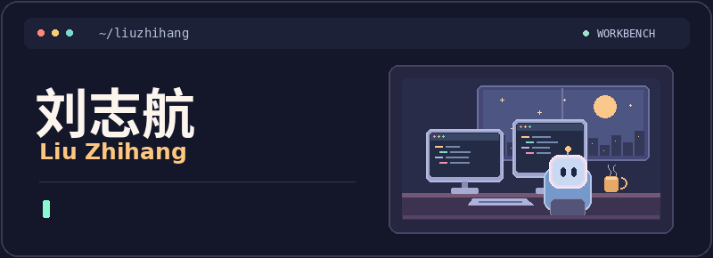
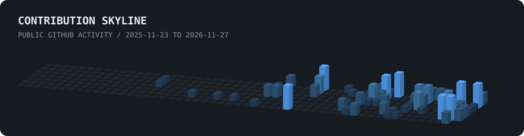

<picture>
  <source media="(prefers-reduced-motion: reduce)" srcset="./assets/workbench-still.png">
  
</picture>

<p>
  <a href="https://liuzhihang.com/"></a>
  <a href="https://x.com/liuzhihangs"></a>
  <a href="https://liuzhihang.com/oss/pic/wechat.jpg"></a>
</p>

## 👋 关于我

Java 后端开发者、IntelliJ IDEA 插件作者。写 AI 研发实践，做自己工作中用得上的工具。

- 🧩 在维护 **[Doc View](https://github.com/liuzhihang/doc-view)**，让查接口、写文档少一些重复操作。
- 🧪 在用 **OpenSpec + 编码 Agent** 跑需求、开发、自测和验收。
- 🏃 理论跑步爱好者，实践派插件作者。

## 🧩 开源作品

**[Doc View](https://github.com/liuzhihang/doc-view)**  
在 IntelliJ IDEA 里从 Java 源码生成接口文档，支持 Markdown 等输出。  
[](https://plugins.jetbrains.com/plugin/15305-doc-view) [](https://plugins.jetbrains.com/plugin/15305-doc-view) [](https://plugins.jetbrains.com/plugin/15305-doc-view) [](https://github.com/liuzhihang/doc-view)

- **[Toolkit](https://github.com/liuzhihang/toolkit)**：IDEA 提效工具箱，包含 JSON 转换、MyBatis 跳转等常用功能。 [](https://plugins.jetbrains.com/plugin/12384-toolkit)
- **[karpathy-agents-md](https://github.com/liuzhihang/karpathy-agents-md)**：给编码 Agent 的简明协作准则，提供 `AGENTS.md` 和 Skill。

## ✍️ 博客

**精选**：[五张图看懂 Loop Engineering](https://liuzhihang.com/posts/loop-engineering-visual-guide/)

**最新发布**

<!-- BLOG-POST-LIST:START -->
- [出了事故，就该禁止 AI 写代码吗？](https://liuzhihang.com/posts/ai-coding-incident-checks/)
- [SDD 研发框架：我更推荐 OpenSpec](https://liuzhihang.com/posts/sdd-framework-why-openspec/)
- [GPT-6.2 发布：AGENTS.md 该留什么？](https://liuzhihang.com/posts/gpt-6-2-agents-md/)
- [GPT-6.2 使用速查](https://liuzhihang.com/posts/gpt-6-2-codex-definition-of-done/)
- [GPT-6.2 API 迁移：别只换模型名](https://liuzhihang.com/posts/gpt-6-2-api-migration/)
<!-- BLOG-POST-LIST:END -->

## 🧰 常用工具

**后端与数据**  


**开发与交付**  


**AI 研发**  
[](https://openai.com/codex/) [](https://antigravity.google/) [](https://github.com/Fission-AI/OpenSpec)

## 📊 开发者数据室

<p align="center">
  <a href="https://github.com/liuzhihang"></a>
  <a href="https://leetcode.cn/u/liuzhihang/"></a>
</p>

<details>
<summary>🗓️ 展开公开贡献周报 · 星期分布</summary>
<br>

```text
Mon  126  ████████████████  26.7%
Tue   53  ███████░░░░░░░░░  11.2%
Wed   57  ███████░░░░░░░░░  12.1%
Thu   13  ██░░░░░░░░░░░░░░   2.8%
Fri   49  ██████░░░░░░░░░░  10.4%
Sat   48  ██████░░░░░░░░░░  10.2%
Sun  126  ████████████████  26.7%
```

<sub>GitHub 公开贡献日历快照，2025-11-23 至 2026-11-26；包含贡献日历计入的各类活动，不等同于提交次数、编码时长或 AI 使用时长。</sub>
</details>

<details>
<summary>🏙️ 展开开发者数据室 · 3D 贡献城市 / 提交时段</summary>
<br>
<picture>
  <source media="(prefers-color-scheme: dark)" srcset="./assets/profile-skyline-dark.svg">
  <source media="(prefers-color-scheme: light)" srcset="./assets/profile-skyline-light.svg">
  
</picture>
<p></p>
</details>

<details>
<summary>🎲 展开一个程序员冷笑话</summary>
<br>

</details>

## 🕹️ 贡献街机

<picture>
  <source media="(prefers-color-scheme: dark)" srcset="./assets/profile-arcade-dark.svg">
  <source media="(prefers-color-scheme: light)" srcset="./assets/profile-arcade-light.svg">
  
</picture>

<sub>地图来自我的 <a href="https://github.com/liuzhihang">GitHub 公开贡献记录</a>，由 <a href="https://github.com/abozanona/pacman-contribution-graph">Pac-Man Contribution Graph</a> 生成；预览使用快照，暂未启用定时刷新。</sub>
