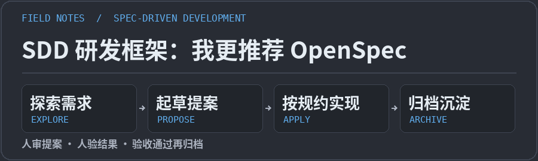

<picture>
  <source media="(prefers-reduced-motion: reduce)" srcset="./assets/workbench-one.webp">
  
</picture>

  <picture>
    <source media="(prefers-reduced-motion: reduce)" srcset="./assets/typing-one-still.svg">
    
  </picture>

  
  
  
  

## 👋 关于我

Java 后端开发者、IntelliJ IDEA 插件作者。我在做自己用得上的工具，也记录 AI Engineering 实践：SDD、编码 Agent 与交付验证。

- 🧩 在维护 **[Doc View](https://github.com/liuzhihang/doc-view)**，让查接口、写文档少一些重复操作。
- 🧪 在用 **OpenSpec + 编码 Agent** 跑需求、开发、自测和验收。
- 🏃 理论跑步爱好者，实践派插件作者。

> 学，而知不足；教，然后知困！

## 🧩 开源作品

### [Doc View](https://github.com/liuzhihang/doc-view)

在 IntelliJ IDEA 里从 Java 源码生成接口文档，支持 Markdown 导出。

 ·  · 

### [Toolkit](https://github.com/liuzhihang/toolkit)

IntelliJ IDEA 工具箱：JSON 转换、MyBatis 跳转等。

 ·  · 

### [karpathy-agents-md](https://github.com/liuzhihang/karpathy-agents-md)

基于 [Multica 的 andrej-karpathy-skills](https://github.com/multica-ai/andrej-karpathy-skills) 的 fork，为不同编码 Agent 整理 `AGENTS.md` 和 Skill。

 · 

## ✍️ 博客

<a href="https://liuzhihang.com/posts/sdd-framework-why-openspec/">
  <picture>
    <source media="(prefers-color-scheme: light)" srcset="./assets/sdd-feature-one-light.png">
    
  </picture>
</a>

**最新发布**

<!-- BLOG-POST-LIST:START -->
- `2026-11-21` · [出了事故，就该禁止 AI 写代码吗？](https://liuzhihang.com/posts/ai-coding-incident-checks/)
- `2026-11-19` · [GPT-6.2 发布：AGENTS.md 该留什么？](https://liuzhihang.com/posts/gpt-6-2-agents-md/)
- `2026-11-19` · [GPT-6.2 API 迁移：别只换模型名](https://liuzhihang.com/posts/gpt-6-2-api-migration/)
- `2026-11-19` · [GPT-6.2 使用速查](https://liuzhihang.com/posts/gpt-6-2-codex-definition-of-done/)
- `2026-11-03` · [Your Harness. You Define It.](https://liuzhihang.com/posts/deepseek-creator-two-plugins/)
<!-- BLOG-POST-LIST:END -->

## 🧰 常用工具

| 分类 | 工具 |
| :--- | :--- |
| 后端与数据 |  |
| 开发与交付 |  |
| AI 研发 |    |

## 📊 开发者数据室

  
  

🏙️ 展开 3D 贡献城市

 
<picture>
  <source media="(prefers-color-scheme: dark)" srcset="./assets/profile-skyline-dark.svg">
  <source media="(prefers-color-scheme: light)" srcset="./assets/profile-skyline-light.svg">
  
</picture>

🎲 展开一个程序员冷笑话

最难复现的 bug？那个只在你说「我演示一下」的时候才不出现的。

## 🕹️ 贡献街机

<picture>
  <source media="(prefers-reduced-motion: reduce) and (prefers-color-scheme: dark)" srcset="./assets/profile-arcade-still-dark.svg">
  <source media="(prefers-reduced-motion: reduce)" srcset="./assets/profile-arcade-still-light.svg">
  <source media="(prefers-color-scheme: dark)" srcset="./assets/profile-arcade-dark.svg">
  <source media="(prefers-color-scheme: light)" srcset="./assets/profile-arcade-light.svg">
  
</picture>

地图来自我的 <a href="https://github.com/liuzhihang">GitHub 公开贡献记录</a>，由 <a href="https://github.com/abozanona/pacman-contribution-graph">Pac-Man Contribution Graph</a> 生成；<a href="./.github/workflows/refresh-profile.yml">默认分支自动刷新</a>，预览分支展示最近一次生成的快照。
