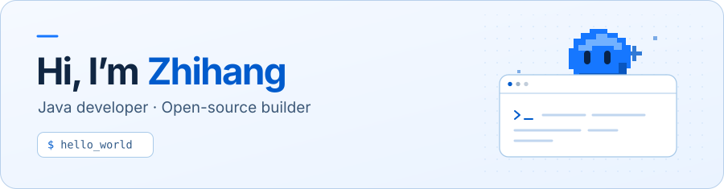
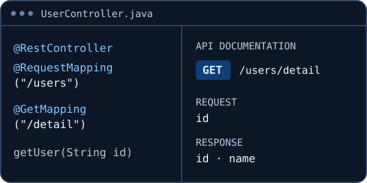
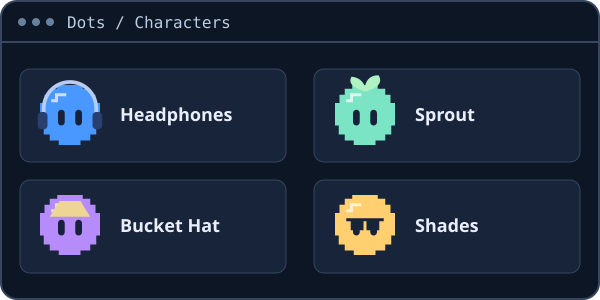

<picture>
  <source media="(prefers-color-scheme: dark)" srcset="assets/profile/hero-dark.svg">
  
</picture>

I build developer tools for Java and write about AI coding and spec-driven development.

**[Personal Blog ↗](https://liuzhihang.com/)** · **[X ↗](https://x.com/liuzhihangs)**

## Featured Projects

<table>
  <tr>
    <td width="50%" valign="top">
      
       <strong><a href="https://github.com/liuzhihang/doc-view">Doc View</a></strong>
       Generate API docs from Java source in IntelliJ IDEA without starting the service.
       <a href="https://plugins.jetbrains.com/plugin/15305-doc-view">JetBrains Marketplace ↗</a>
    </td>
    <td width="50%" valign="top">
      
       <strong><a href="https://github.com/liuzhihang/dots">Dots</a></strong>
       Browse, customize, and export character avatars for ChatGPT.
       <a href="https://dots.liuzhihang.chatgpt.site/">Live gallery ↗</a>
    </td>
  </tr>
</table>

## Recent Updates

- `RELEASE` [Doc View v1.7.2](https://github.com/liuzhihang/doc-view/releases/tag/v1.7.2)
- `WRITING` [SDD 研发框架：我更推荐 OpenSpec](https://liuzhihang.com/posts/sdd-framework-why-openspec/)
- `WRITING` [AI 研发：我为什么推荐大家使用 SDD](https://liuzhihang.com/posts/ai-rd-sdd/)

[View all posts ↗](https://liuzhihang.com/articles/)

## Contribution Arcade

<picture>
  <source media="(prefers-color-scheme: dark)" srcset="assets/profile/arcade-dark.svg">
  
</picture>

[View my GitHub contributions ↗](https://github.com/liuzhihang)

  
More projects and links

  - JetBrains plugins: [Toolkit](https://github.com/liuzhihang/toolkit) · [Copy as JSON](https://github.com/liuzhihang/copy-as-json)
  - Elsewhere: [WeChat](https://liuzhihang.com/oss/pic/wechat.jpg) · [Yuque](https://www.yuque.com/liuzhihangs) · [CSDN](https://blog.csdn.net/qq_36535538) · [Zhihu](https://www.zhihu.com/people/liuzhihang)

