# 刘志航 · Liu Zhihang

Java 后端开发者、IntelliJ IDEA 插件作者。写 AI 研发实践，做自己工作中用得上的工具。

[博客](https://liuzhihang.com/) · [X](https://x.com/liuzhihangs) · [公众号 · 程序员小航](https://liuzhihang.com/oss/pic/wechat.jpg)

<picture>
  <source media="(prefers-color-scheme: dark)" srcset="./assets/vibe-terminal-dark.svg">
  <source media="(prefers-color-scheme: light)" srcset="./assets/vibe-terminal-light.svg">
  
</picture>

## 开源作品

**[Doc View](https://github.com/liuzhihang/doc-view)**  
在 IntelliJ IDEA 里从 Java 源码生成接口文档。 · [JetBrains Marketplace](https://plugins.jetbrains.com/plugin/15305-doc-view)

- **[Toolkit](https://github.com/liuzhihang/toolkit)**：IDEA 提效工具箱，包含 JSON 转换、MyBatis 跳转等常用功能。
- **[karpathy-agents-md](https://github.com/liuzhihang/karpathy-agents-md)**：给编码 Agent 的简明协作准则，提供 `AGENTS.md` 和 Skill。

## 最新文章

<!-- BLOG-POST-LIST:START -->
- [五张图看懂 Loop Engineering](https://liuzhihang.com/posts/loop-engineering-visual-guide/)
- [什么是 Loop Engineering？AI Coding 正在从 Prompt 走向 Loop](https://liuzhihang.com/posts/loop-engineering/)
- [出了事故，就该禁止 AI 写代码吗？](https://liuzhihang.com/posts/ai-coding-incident-checks/)
<!-- BLOG-POST-LIST:END -->

## 最近在做

- 维护 Doc View，继续打磨在 IDEA 里查接口、写文档的体验。
- 用 OpenSpec 和编码 Agent 跑需求、开发、自测、验收，再把有用的方法写下来。

> 学，而知不足；教，然后知困！

## 贡献街机

*预览占位，不代表真实贡献。正式版由 GitHub Actions 生成。*
