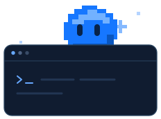

# Hi, I’m Zhihang.

I build developer tools for Java and write about AI coding and spec-driven development.

[Personal Blog](https://liuzhihang.com/) &nbsp;·&nbsp; [X](https://x.com/liuzhihangs)

## Building

**[Doc View](https://github.com/liuzhihang/doc-view)** 
Generate API docs from Java source in IntelliJ IDEA without starting the service. 
[JetBrains Marketplace](https://plugins.jetbrains.com/plugin/15305-doc-view) · [v1.7.2 release notes](https://github.com/liuzhihang/doc-view/releases/tag/v1.7.2)

**[Dots](https://github.com/liuzhihang/dots)** 
Browse, customize, and export character avatars for ChatGPT. 
[Explore the gallery](https://dots.liuzhihang.chatgpt.site/)

## Writing

- [SDD 研发框架：我更推荐 OpenSpec](https://liuzhihang.com/posts/sdd-framework-why-openspec/)
- [AI 研发：我为什么推荐大家使用 SDD](https://liuzhihang.com/posts/ai-rd-sdd/)

[Browse all posts](https://liuzhihang.com/articles/)

## Contribution Arcade

<picture>
  <source media="(prefers-color-scheme: dark)" srcset="assets/profile/arcade-dark.svg">
  
</picture>

  
More projects and links

  - JetBrains plugins: [Toolkit](https://github.com/liuzhihang/toolkit) · [Copy as JSON](https://github.com/liuzhihang/copy-as-json)
  - Elsewhere: [WeChat](https://liuzhihang.com/oss/pic/wechat.jpg) · [Yuque](https://www.yuque.com/liuzhihangs) · [CSDN](https://blog.csdn.net/qq_36535538) · [Zhihu](https://www.zhihu.com/people/liuzhihang)

